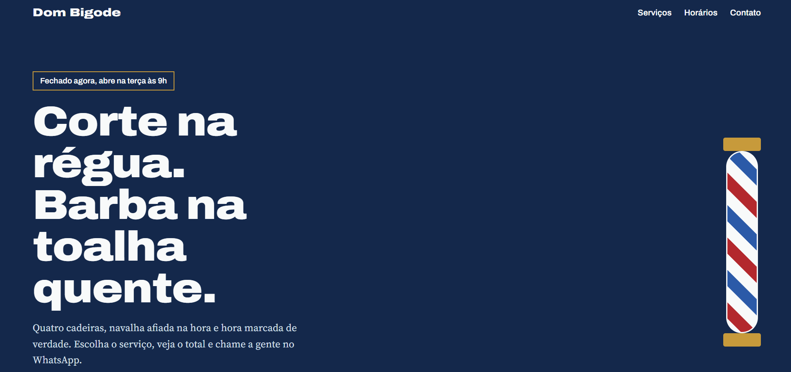

# Barbearia Dom Bigode

Site de uma barbearia fictícia que resolve um problema comum: o cliente quer saber preço e horário sem precisar mandar três mensagens. Ele marca os serviços, vê o total na hora e abre o WhatsApp já com o pedido escrito.

**Site no ar:** https://barbearia-dom-bigode-one.vercel.app/



_Troque a imagem acima por um print real do site publicado (crie a pasta `docs/` e salve o arquivo como `screenshot.png`)._

## O que o site faz

- Mostra se a barbearia está aberta agora, usando o fuso de São Paulo.
- Calcula o total dos serviços marcados.
- Monta uma mensagem de agendamento e abre o WhatsApp com ela.
- Destaca o dia de hoje na tabela de horários.
- Funciona em celular e computador, respeita `prefers-reduced-motion` e tem foco visível para teclado.

## Tecnologias

HTML, CSS e JavaScript puro, empacotados com [Vite](https://vite.dev). Sem banco de dados e sem variáveis de ambiente por enquanto.

## Rodar localmente

```bash
npm install
npm run dev      # servidor local com recarga automática
npm run build    # gera a pasta dist/, o mesmo comando que a plataforma de hospedagem usa
npm run preview  # abre a versão gerada pelo build
```

## Personalizar

- Número do WhatsApp: constante `WHATSAPP` em `src/main.js` (só dígitos, com 55 e DDD).
- Serviços e preços: lista em `index.html` (atributo `data-price`).
- Horários: objeto `HOURS` em `src/main.js` e tabela em `index.html`.

## Publicação

Importe o repositório na Vercel. Ela detecta o Vite sozinha: comando `npm run build` e pasta de saída `dist`.

## Segredos

O arquivo `.env` está no `.gitignore`. Use `.env.example` como modelo e cadastre os valores reais apenas no painel da plataforma.

---

Projeto de portfólio. Endereço, telefone e nome da barbearia são fictícios.
